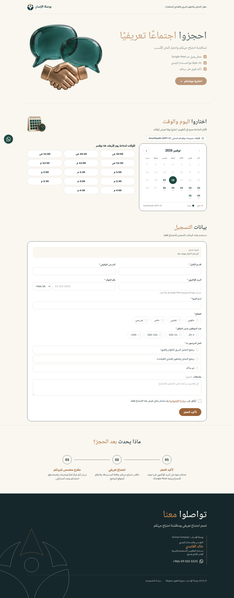

# بوصلة الإنسان — Human Compass · Booking site

Arabic (RTL), mobile-first booking site for **Human Compass (بوصلة الإنسان)**.
Visitors pick a day and time from live availability, fill in a short registration form, and
the booking becomes an event — with a Google Meet link and an email invitation — on the
dedicated Google Calendar **"بوصلة الإنسان"**. Booked slots disappear from the site immediately.

- **Stack:** Next.js 16 (App Router, Cache Components) · TypeScript · Tailwind CSS v4 · zod · Vercel
- **Design:** see [`DESIGN.md`](DESIGN.md) — tokens, type scale, components, all taken from `brand/brochure.pdf`
- **Pages:** `/` booking · `/confirmed` summary + Meet link + .ics · `/privacy`
- **API:** `GET /api/availability` · `POST /api/book` · `GET /api/health`

| Desktop | Mobile (visitor in Cairo) |
|---|---|
|  |  |

---

## Quick start (no Google account needed)

```bash
npm install
```

```bash
npm run dev:mock
```

Open http://localhost:3000. `CALENDAR_PROVIDER=mock` uses an in-memory calendar with a few
seeded busy blocks, so you can click through the whole flow and get a fake Meet link.

---

## Setup with Google Calendar

### 1. Create the "بوصلة الإنسان" calendar

1. Open [Google Calendar](https://calendar.google.com) with the Google account that will **own** the bookings.
2. Left sidebar → **Other calendars (+)** → **Create new calendar**.
3. Name: `بوصلة الإنسان` · Time zone: **(GMT+03:00) Arabian Standard Time – Riyadh** → **Create calendar**.
4. Open the calendar's **Settings and sharing**:
   - **Access permissions for events** → make sure **Make available to public is OFF**.
     Bookings contain clients' names, emails and phone numbers.
   - **Share with specific people or groups** → add the consultant's email with
     **Make changes to events**, so he sees bookings and gets notifications on his own account.
   - **Integrate calendar** → copy the **Calendar ID** (`xxxx@group.calendar.google.com`).
     You will paste it into `GOOGLE_CALENDAR_ID`.

> The site only ever writes to `GOOGLE_CALENDAR_ID` — never to the account's primary calendar.

### 2. Create a Google Cloud project and enable the Calendar API

1. Go to <https://console.cloud.google.com/> → project picker → **New project** (e.g. `human-compass-booking`).
2. **APIs & Services → Library** → search **Google Calendar API** → **Enable**.

### 3. OAuth consent screen + OAuth client

1. **APIs & Services → OAuth consent screen** (called *Google Auth Platform* in newer consoles):
   - User type: **External** (or *Internal* if this is a Google Workspace account).
   - App name `Human Compass Booking`, support email, developer email.
   - **Data access / Scopes** → add:
     - `https://www.googleapis.com/auth/calendar.events`
     - `https://www.googleapis.com/auth/calendar.freebusy`
     - `https://www.googleapis.com/auth/calendar.calendarlist.readonly` (used once by the setup script to list your calendar IDs)
   - **Audience / Test users** → add the calendar owner's email (needed while in Testing).
2. **Publish to Production** — important:
   - In **Audience** (or *OAuth consent screen → Publishing status*) click **Publish app** → **Confirm**.
   - While an External app is in **Testing**, Google **expires refresh tokens after 7 days** and bookings
     would start failing. In **Production** the token does not expire.
   - Google may show "unverified app" during authorisation, because the calendar scopes are sensitive. Since only
     you authorise it, once, that's fine: click **Advanced → Go to Human Compass Booking (unsafe)**.
     Verification is only required if other people sign in.
3. **APIs & Services → Credentials → Create credentials → OAuth client ID**:
   - Application type: **Desktop app** (the setup script uses a loopback redirect, which Desktop clients allow).
   - Copy the **Client ID** and **Client secret**.

> We use OAuth with the calendar owner's account rather than a service account: on a regular Gmail
> account a service account cannot invite attendees or create Meet links without Domain-Wide Delegation.

### 4. Get the refresh token (run once, locally)

```bash
cp .env.example .env.local
```

Put `GOOGLE_CLIENT_ID` and `GOOGLE_CLIENT_SECRET` in `.env.local`, then:

```bash
npm run google:token
```

A browser window opens. **Sign in with the account that owns the "بوصلة الإنسان" calendar** and allow access.
The terminal then prints:

```
GOOGLE_REFRESH_TOKEN=1//0g…
Calendars you can write to:
  • بوصلة الإنسان  ← use this one
    id: c_1a95…@group.calendar.google.com
GOOGLE_CALENDAR_ID=c_1a95…@group.calendar.google.com
```

Copy those values into `.env.local`, set `CALENDAR_PROVIDER=google`, and check it:

```bash
npm run dev
```

```bash
curl http://localhost:3000/api/health
```

Expected: `{"ok":true, … "token":{"ok":true},"bookingCalendar":{"ok":true}}`.
The health route returns only ok/error flags — no event data, no busy times, and masked calendar IDs.

### 5. Deploy on Vercel

1. Push the repo to GitHub → <https://vercel.com/new> → import it (framework: Next.js, no settings to change).
2. **Settings → Environment Variables** — add for *Production* (and *Preview* if you want previews to book for real):

| Variable | Required | Value |
|---|---|---|
| `CALENDAR_PROVIDER` | yes | `google` (or `mock` for a demo deployment) |
| `GOOGLE_CLIENT_ID` | yes | from step 3 |
| `GOOGLE_CLIENT_SECRET` | yes | from step 3 |
| `GOOGLE_REFRESH_TOKEN` | yes | from step 4 |
| `GOOGLE_CALENDAR_ID` | yes | the "بوصلة الإنسان" calendar ID |
| `BUSY_CALENDAR_IDS` | no | extra calendars that block slots, comma-separated — e.g. `primary` |
| `BOOKING_WEBHOOK_URL` | no | URL that receives each booking as JSON |
| `BOOKING_WEBHOOK_SECRET` | no | signs the webhook body (`X-Signature: sha256=…`) |
| `NEXT_PUBLIC_SITE_URL` | recommended | `https://your-domain` (Open Graph metadata) |
| `NEXT_PUBLIC_LOCALE` | no | `ar` (default) |

Or with the CLI:

```bash
vercel env add GOOGLE_REFRESH_TOKEN production
```

3. **Deploy**, then open `https://your-domain/api/health` to confirm.

All of `.env.example` is documented inline. Secrets are only read in server route handlers
(`lib/server/*` imports `server-only`), so none of them can reach the browser bundle.

### 5b. …or deploy to any other host (one self-contained folder)

The site needs a **Node.js 20+** server (the Google Calendar calls run server-side). It does
**not** need Vercel. Build a portable folder:

```bash
NEXT_PUBLIC_SITE_URL=https://your-domain npm run package
```

This creates **`deploy/`** (≈24 MB) and **`deploy.zip`** (≈6 MB):

```
deploy/
  server.js              ← the whole site: node server.js
  .next/ public/         built pages, assets, pre-sized images
  node_modules/          only what the server needs (pure JS, no native binaries)
  .env.example           copy to .env and fill in
  start.sh / start.cmd   Linux-macOS / Windows starters
  ecosystem.config.cjs   PM2
  Dockerfile             Docker
  DEPLOY.md              host-by-host instructions + Nginx example
```

Copy the folder (or upload and unzip the zip) to the host, then:

```bash
cp .env.example .env
```

```bash
./start.sh
```

No `npm install` and no build on the host. It works on a VPS, cPanel/Plesk "Node.js App" (startup file `server.js`),
Docker, PM2, Render, Railway, Fly, Hostinger and the like. Plain static/PHP-only hosting can't run it.
`deploy/DEPLOY.md` has the details for each.

- Settings are read at runtime from `.env` in the folder (or the host's environment variables), except
  `NEXT_PUBLIC_SITE_URL`, which is baked in at package time.
- Run **one** process. The rate limit and slot lock are in memory.
- Images: `npm run images` pre-generates responsive WebP sizes into `public/images/_w/` (already committed),
  so no image optimizer or `sharp` binary is needed on the host. Re-run it after adding or replacing an image in `public/images/`.
- `npm run test:e2e` can test the packaged folder exactly as a host runs it:
  `E2E_DEPLOY_DIR=$PWD/deploy node tests/e2e.cjs` (it writes a test `.env` into that folder).

### 6. Day-to-day changes

| What | Where |
|---|---|
| **Working hours**, working days, breaks, holidays, buffer, minimum notice, booking horizon, max sessions per day | [`config/availability.ts`](config/availability.ts) |
| **Session types** (title, description, duration, `active`, calendar colour) and the individual paths/prices | [`config/sessions.ts`](config/sessions.ts) |
| **All text on the site** (headlines, form labels, validation messages, privacy page, footer) | [`content/ar.ts`](content/ar.ts) |
| WhatsApp number | [`config/site.ts`](config/site.ts) |
| Colours / fonts | `app/globals.css` (`@theme`) · `lib/fonts.ts` |
| Images | replace a file in `public/images/`, then `npm run images` |

Edit, commit, and Vercel redeploys automatically.

- **Headline accent:** wrap one word in `**…**` in `content/ar.ts` to colour it copper — `"احجزوا **اجتماعًا تعريفيًا**"`.
- **Session-type picker:** it appears automatically when more than one session type has `active: true`.
  The individual call (`individual-intro`, 20 min, with the 1,500 / 2,500 SAR paths) is currently
  `active: false`, so the page offers only the organisation meeting.
- **Other calendars blocking time:** add them to `BUSY_CALENDAR_IDS` (e.g. `primary,consultant@gmail.com`).
  The authorising account needs at least *See only free/busy* access to each. If any of them can't be read,
  the site shows *no* slots rather than risk double-booking.
- **English version:** add `content/en.ts` (same `Content` type, `brandName: "Human Compass"`, `dir: "ltr"`),
  register it in `content/index.ts`, set `NEXT_PUBLIC_LOCALE=en`. Add `en` strings next to `ar` in `config/sessions.ts`.
- **Thmanyah fonts:** drop the files in `brand/fonts/` and follow the snippet at the top of `lib/fonts.ts`.
  Check the Thmanyah licence covers web embedding before shipping.

---

## How booking works

1. `GET /api/availability?sessionType=org-intro` — runs `freebusy.query` over `GOOGLE_CALENDAR_ID` + `BUSY_CALENDAR_IDS`,
   counts site bookings per day, and generates slots in **Asia/Riyadh** from `config/availability.ts`.
   Slots are returned as UTC instants; the browser shows them in the **visitor's own time zone** and,
   if that differs from Riyadh, adds the Riyadh time under each slot.
2. `POST /api/book` — rate-limited (5 per IP per 10 min), honeypot field, zod validation with Arabic messages.
   Right before inserting, the server **re-runs availability** and only proceeds if the requested start
   is still a valid slot (per-instance lock on that slot as well). Otherwise it returns `409 SLOT_TAKEN`, and the
   page shows *"عذرًا، تم حجز هذا الموعد للتو…"* and refreshes the slots.
3. The event is inserted into `GOOGLE_CALENDAR_ID` with:
   title `اجتماع تعريفي للجهات — [الاسم] ([الجهة])`, every form field in the description, the client as attendee,
   `sendUpdates=all` (Google emails the invitation), a Meet link via `conferenceData.createRequest` + `conferenceDataVersion=1`,
   the session type's colour, and a private `hcBooking=1` tag (used for the per-day cap).
4. If `BOOKING_WEBHOOK_URL` is set, the booking JSON is POSTed after the response is sent. A failing webhook never fails a booking.

<details>
<summary>Webhook payload</summary>

```json
{
  "event": "booking.created",
  "bookingId": "abc123",
  "createdAt": "2026-11-17T09:12:00.000Z",
  "sessionType": "org-intro",
  "sessionTitle": "اجتماع تعريفي للجهات",
  "start": "2026-11-18T07:00:00.000Z",
  "end": "2026-11-18T07:30:00.000Z",
  "timeZone": "Asia/Riyadh",
  "meetLink": "https://meet.google.com/xxx-xxxx-xxx",
  "client": {
    "sessionType": "اجتماع تعريفي للجهات",
    "fullName": "…", "jobTitle": "…", "email": "…", "phone": "+9665…",
    "organization": "…", "sector": "حكومي", "employees": "101–500",
    "solution": "برنامج التحليل والتطوير القيادي (للقيادات)", "notes": "…", "timeZone": "Europe/Berlin"
  }
}
```

In Make / Zapier: *Webhooks → Custom webhook* → map fields to a monday.com item or a Google Sheets row.
</details>

### Notes and limits

- The rate limiter and slot lock live in memory per server instance. On Vercel Fluid Compute instances are reused,
  which covers normal traffic. For a hard global limit, add a Vercel Firewall rate-limit rule on `/api/book`.
- Two bookings for the same slot landing on two different instances within the same ~second could both pass
  the re-check. For a consultancy's traffic this is extremely unlikely; if it ever happens, both appear in the calendar.
- The confirmation page reads the booking from `sessionStorage` (no personal data in URLs). Opening `/confirmed`
  directly shows a friendly empty state; the email invitation is the durable record.

---

## Tests

```bash
npm test
```

21 unit tests: slot maths across **Riyadh (UTC+3, no DST), Cairo (UTC+2 / +3 in summer), Berlin / London (DST)** and a
Los Angeles visitor whose slot falls on the previous local day, plus buffers, notice, horizon, daily cap, breaks,
blocked dates, phone normalisation and `.ics` folding.

```bash
npm run test:e2e
```

Builds the app, then runs the **real production server and real Google client code** against a fake Google
OAuth + Calendar API (`tests/fake-google.cjs`) with Playwright (19 checks): health, availability, `primary` busy time
blocking slots, slot display in three time zones, validation messages, a full booking (asserting the exact event
sent to Google: summary, attendee, `sendUpdates`, `conferenceDataVersion`, colour, description), the slot disappearing,
the signed webhook, the race "slot taken meanwhile", the honeypot, the rate limit, and that no secrets ship to the browser.
Screenshots go to `docs/screenshots/e2e/` (git-ignored). Needs Playwright's Chromium (`npx playwright install chromium` if missing).

Lighthouse (mobile, run against the packaged `deploy/` folder, 3 runs): **Performance 86–99 (median 92) ·
Accessibility 100 · Best practices 100 · SEO 100**, CLS 0.

---

## Project layout

```
app/                    pages + route handlers (api/availability, api/book, api/health)
components/             Header, Footer, Logo (vector from the brochure), booking/*
config/                 availability.ts · sessions.ts · site.ts
content/                ar.ts (all copy) · types.ts · index.ts
lib/                    time/slot maths, zod schema, formatting, .ics
lib/server/             Google client, mock calendar, booking, rate limit, webhook (server-only)
scripts/                get-refresh-token.ts · build-images.mjs · package.mjs
tests/                  unit tests, fake Google server, e2e
brand/                  brochure.pdf (design source) · fonts/ (Thmanyah, when added)
public/images/          3D renders extracted from the brochure (WebP, alpha); _w/ = pre-sized variants
deploy/                 generated by `npm run package` (git-ignored)
DESIGN.md               design system
```
